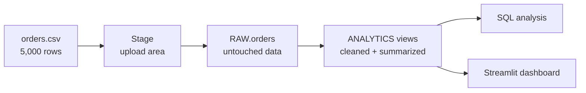

# Retail Sales Analytics on Snowflake

A beginner-friendly, end-to-end data project on Snowflake. It loads 5,000 fake retail orders from a CSV file, cleans them with SQL, answers business questions, and shows the results in a Streamlit dashboard.

> New here? Start with [`SETUP.md`](SETUP.md) for step-by-step instructions to run the project yourself.

## What this project does

A company has thousands of sales records in a spreadsheet. This project moves them into Snowflake and answers questions such as:

- Who are our best customers?
- Are sales growing month over month?
- Which product category makes the most profit in each region?

## Architecture

| Layer | Schema | Contents |
|---|---|---|
| Raw | `SALES_DB.RAW` | The `orders` table, loaded exactly as the CSV provides it |
| Analytics | `SALES_DB.ANALYTICS` | Views `clean_orders` and `monthly_sales`, plus the `daily_summary` table |

Keeping raw and cleaned data apart means a mistake in cleaning never damages the original data.

## Project files

| File | Purpose |
|---|---|
| [`generate_data.py`](generate_data.py) | Generates the sample dataset (fixed random seed, so output is repeatable) |
| [`orders.csv`](orders.csv) | The generated dataset: 5,000 orders from 2023 to 2024 |
| [`sales_project.sql`](sales_project.sql) | All SQL for the project, in order |
| [`SETUP.md`](SETUP.md) | Step-by-step guide to run everything |

## Dataset

| Column | Type | Description |
|---|---|---|
| `order_id` | STRING | Unique ID, for example `ORD-00001` |
| `order_date` | DATE | Order date, 2023-01-01 to 2024-12-31 |
| `customer` | STRING | One of 100 customers |
| `category` | STRING | Furniture, Technology or Office Supplies |
| `region` | STRING | East, West, Central or South |
| `sales` | NUMBER(12,2) | Sale amount |
| `profit` | NUMBER(12,2) | Profit on the sale |

The data is fake and safe to share.

## What each step does

| # | Step | Snowflake concept | Result |
|---|---|---|---|
| 1 | Setup | Warehouse, database, schema | `LEARN_WH`, `SALES_DB`, `RAW`, `ANALYTICS` |
| 2 | File format, stage, table | Stage, file format | `csv_fmt`, `my_stage`, empty `orders` table |
| 3 | Upload | Internal stage | `orders.csv` on the stage |
| 4 | Load | `COPY INTO` | 5,000 rows in `orders` |
| 5 | Clean and transform | Views | `clean_orders`, `monthly_sales` |
| 6 | Analyze | `GROUP BY`, `LAG()`, `RANK()` | Three business queries |
| 7 | Visualize | Chart tab, Streamlit | Bar and line charts, dashboard |
| 8 | Advanced (optional) | Clone, Time Travel, tasks | Backup table, data recovery, scheduled job |
| 9 | Clean up | Suspend and drop | No wasted credits |

## Analysis queries

1. **Top 10 customers by revenue** uses `GROUP BY`, `SUM` and `ORDER BY ... LIMIT`.
2. **Month-over-month growth** uses the `LAG()` window function.
3. **Most profitable category per region** uses `RANK() OVER (PARTITION BY ...)`.

## Snowflake features demonstrated

- **Warehouse:** compute that is separate from storage. It is `XSMALL` with `AUTO_SUSPEND = 60` to keep costs low.
- **Stage and `COPY INTO`:** the standard way to load files.
- **Views:** saved queries that store no data and always show current results.
- **Window functions:** `LAG()` and `RANK()`.
- **Zero-copy clone:** an instant copy of a table with no extra storage.
- **Time Travel:** query or recover data as it was in the past.
- **Tasks:** SQL jobs that Snowflake runs on a schedule.
- **Streamlit in Snowflake:** a dashboard that runs inside Snowflake.

## Quick start

1. Create a free Snowflake trial account.
2. Run `python generate_data.py` (or use the included `orders.csv`).
3. Follow [`SETUP.md`](SETUP.md).

## Cost

A trial account includes free credits. This project uses an `XSMALL` warehouse that suspends itself after 60 seconds, so it uses a very small amount. The only thing that can keep spending credits is a resumed task, so the setup guide tells you to leave it suspended.

## Ideas for what to build next

- Load JSON into a `VARIANT` column and query it.
- Run the queries from Python with `snowflake-connector-python`.
- Use streams and tasks to build an automatic pipeline.
- Replace the fake data with a real dataset such as Superstore Sales.
